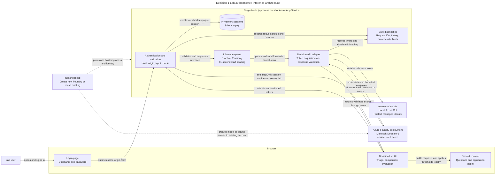

# Decision-1 Lab

An interactive learning PoC for [Microsoft-Decision-1](https://commandline.microsoft.com/microsoft-decision-1-model-foundry/): turn a synthetic support ticket into **team probabilities, urgency probability, and a severity score**, then apply your own routing policy.

Built with Node.js and vanilla HTML/CSS/JavaScript. The PoC is deployed to **Azure App Service**. This repository includes Azure Developer CLI (`azd`) and Bicep configuration for your own deployment, plus a local development workflow.

The deployed hostname, subscription and tenant IDs, resource names, and login credentials are intentionally omitted from this public-facing guide. All configuration examples use dummy values.

> **Learning project, not a production ticket router.** Inference is billable. Use synthetic data only. No ticket is actually routed, and scores are predictions rather than guarantees.

## Contents

- [What the model does](#what-the-model-does)
- [Run locally](#run-locally)
- [Deploy to Azure](#deploy-to-azure)
- [Explore the model](#explore-the-model)
- [Authentication and privacy](#authentication-and-privacy)
- [Queueing and cancellation](#queueing-and-cancellation)
- [Tests and CI](#tests-and-ci)
- [Architecture and project structure](#architecture-and-project-structure)
- [Troubleshooting](#troubleshooting)
- [Cleanup](#cleanup)

## What the model does

One request sends ticket text as `state` and three bounded questions:

| Question | API type | Result |
| --- | --- | --- |
| Which team should handle this? | `choice` | Selected team, option probabilities, and a separate confidence field |
| Does this need urgent escalation? | `noul` | Probability that the condition is true |
| How severe is this? | `score` | Probability-weighted scale index from 0 to 3, with per-level probabilities |

This is **not** Chat Completions, Responses, or a chatbot. The API returns numerical decisions, not a generated explanation.

```text
POST <resource-root-endpoint>/providers/microsoft/v1/systemone
```

The displayed action and explanation come from deterministic application policy:

- Routing passes when the selected team's probability is **at or above** the routing threshold.
- Urgency triggers when its probability is **at or above** the escalation threshold.
- Urgent escalation takes precedence over low-confidence human review.
- Routing uses the selected option's probability, **not** the API's separate `confidence` field.

See the [official Decision API guide](https://learn.microsoft.com/azure/foundry/foundry-models/how-to/use-foundry-models-microsoft-decision). Model availability, supported regions/SKUs, preview lifecycle, quota, and pricing can change; verify them before provisioning.

## Run locally

### Prerequisites

- Node.js **24+** and npm.
- Azure CLI, signed in to an account with Foundry inference permission.
- An existing Microsoft-Decision-1 deployment.
- Azure Developer CLI (`azd`) if using the generated shared login or Azure deployment.

### 1. Configure your deployment

All subscription IDs, resource names, and endpoints below are **dummy examples**. Replace them with your own values. Nothing is preconfigured for another user's subscription or tenant.

```powershell
npm ci
Copy-Item .env.example .env
az login
```

Edit your local `.env`:

```dotenv
AZURE_ENDPOINT=https://example-foundry.cognitiveservices.azure.com
DEPLOYMENT_NAME=decision-1
AZURE_SUBSCRIPTION_ID=00000000-0000-0000-0000-000000000000
PORT=3000
REQUEST_INTERVAL_MS=61000
```

Use the **account root endpoint**, not a project URL ending in `/api/projects/...`. The deployment name can differ from the catalog model name.

### 2. Choose local sign-in

For a private local login, initialize an azd environment and generate credentials:

```powershell
azd env new decision-lab
npm run setup-auth
```

The script creates the username `decisionlab` and a random password in `.azure/app-login.txt`. It writes only the username and password hash to the selected azd environment and, when present, `.env`. Keep the login file private.

Alternatively, local development can omit both `APP_AUTH_USERNAME` and `APP_AUTH_PASSWORD_HASH`. The server is still loopback-only. **Hosted deployment always requires valid authentication configuration.**

### 3. Start the lab

```powershell
npm start
```

Open [http://localhost:3000](http://localhost:3000). If authentication is configured, the site opens its login page, including in VS Code's embedded browser. Stop the server with Ctrl+C.

Local inference uses `AzureCliCredential` on the server with the configured subscription and the scope `https://cognitiveservices.azure.com/.default`. The app does not change your global CLI subscription. Control-plane Owner/Contributor permissions alone do not necessarily grant inference access.

## Deploy to Azure

[azure.yaml](azure.yaml) packages the application for a **single-instance Linux App Service**, using Node.js 24 and a B1 plan.

The infrastructure provides:

- A new environment-specific resource group and web app.
- A system-assigned web-app identity with account-scoped **Cognitive Services User** access.
- Either a new Foundry account/project/model, or access to an existing account.
- HTTPS-only access, TLS 1.2 minimum, disabled FTP, and a `/health` check.
- Shared username/password sign-in, without a client IP allowlist.

**Costs:** App Service B1 has ongoing charges even when idle; model inference incurs separate charges. Check available quota, pricing, and data-zone processing requirements for your selected region. No fixed cost estimate is asserted here.

### Option A: reuse an existing Foundry deployment

Recommended when you already have the model or do not want to allocate more model capacity. The account must be in the selected subscription.

```powershell
az login
azd auth login
# Skip this if you already initialized and selected your environment.
azd env new decision-lab
azd env set AZURE_SUBSCRIPTION_ID "00000000-0000-0000-0000-000000000000"
azd env set AZURE_LOCATION eastus2
azd env set USE_EXISTING_FOUNDRY true
azd env set EXISTING_FOUNDRY_RESOURCE_GROUP "rg-example-foundry"
azd env set EXISTING_FOUNDRY_ACCOUNT_NAME "example-foundry"
azd env set EXISTING_DEPLOYMENT_NAME "decision-1"
npm run setup-auth
azd provision --preview --no-prompt
azd up
```

The model deployment must already exist and support the Decision API. Reuse mode reads the endpoint and assigns inference access to the new web-app identity. It does **not** resize the model or modify the existing account/project configuration.

Provisioning requires permission to create resources in the new group and create a role assignment on the existing account.

### Option B: create a new Foundry account and model

Use a new azd environment with sufficient regional model quota:

```powershell
azd auth login
azd env new decision-lab-new
azd env set AZURE_SUBSCRIPTION_ID "00000000-0000-0000-0000-000000000000"
azd env set AZURE_LOCATION eastus2
azd env set FOUNDRY_LOCATION swedencentral
azd env set USE_EXISTING_FOUNDRY false
npm run setup-auth
azd provision --preview --no-prompt
azd up
```

Defaults: model `Microsoft-Decision-1`, version `1`, deployment `decision-1`, SKU `DataZoneStandard`, capacity `60` requests/minute, Foundry region `swedencentral`. Check that these are supported for your subscription before deploying. Key-based authentication is disabled on newly created Foundry accounts.

`FOUNDRY_LOCATION` selects the Foundry account and model region independently of `AZURE_LOCATION`, which selects the web app and resource group region. Set it with `azd env set FOUNDRY_LOCATION swedencentral`. Additional parameters such as `modelCapacity` can be supplied through [infra/main.parameters.json](infra/main.parameters.json). Avoid switching an already-provisioned environment between modes without reviewing the preview and cleanup implications.

If provisioning reports `InsufficientQuota`, check the model quota in `FOUNDRY_LOCATION`. A new deployment requires 60 available requests/minute with the default capacity. Reuse an existing model deployment with Option A, request additional quota, or select a supported region with sufficient available quota. Quota availability does not guarantee live allocation capacity. Review the preview before changing regions; an existing Foundry account cannot be moved by changing its location.

### Updates and deployment output

```powershell
azd env get-values
azd deploy web       # Code-only update
azd provision        # Infrastructure/settings update
```

Open `SERVICE_WEB_ENDPOINT` from the environment outputs. These outputs can include your resource identifiers; do not publish them.

### Access your hosted app

1. Open your deployment's `SERVICE_WEB_ENDPOINT` over HTTPS.
2. Sign in at `/login` with the credentials generated for that environment. Keep `.azure/app-login.txt` private.
3. Check `/health` for basic server availability. This public endpoint does not call Foundry or verify model access.
4. Submit a synthetic ticket to verify authenticated inference. This calls the model and incurs inference charges.

Publication to App Service alone does not verify login, managed-identity permissions, or model inference. Check those separately for your deployment.

The current hosted PoC passed HTTPS health, login/logout, session protection, and authenticated configuration/queue checks. Its managed-identity role assignment was verified on the existing Foundry account. Hosted model inference has not yet been exercised; these checks made no billable inference requests.

App Service uses `ManagedIdentityCredential` instead of local CLI credentials. Allow time for inference role assignments to propagate.

`npm run build` stages only application files in `dist`; credentials, environment files, tests, and infrastructure are excluded. App Service installs dependencies during deployment and starts with `node server.js`.

## Explore the model

| Experiment | How to use it | What to inspect |
| --- | --- | --- |
| Classification | Select a sample or write a synthetic ticket | Team probabilities and API confidence |
| Policy versus model | Move thresholds after receiving a result | Actions change locally, without another inference call |
| Ambiguity | Mix two kinds of support issue | How probability is distributed |
| Comparison | Write a paraphrase, then run three variants | Original, reversed options, paraphrase; probability deltas, urgency, severity, duration |
| Quick evaluation | Run six examples | Accuracy and completed-ticket results |
| Challenge evaluation | Select the 18-ticket set | Confusion matrix, per-team precision/recall/support, human-review rate, urgency accuracy, severity MAE |

The challenge set includes mixed issues, Portuguese/Spanish input, outages, account compromise, and untrusted instructions inside tickets. Labels are **illustrative**, especially severity targets; this is not a production benchmark.

Metrics use only completed tickets. Precision or recall with no denominator is `null`. Partial results remain after cancellation/errors. Changing the ticket or option order clears stale results; changing thresholds recomputes policy without inference.

The displayed API duration includes network time and response parsing, but excludes token acquisition. Queue wait and inference time including authentication are reported separately. None is pure model latency or a reproduction of published performance claims.

## Authentication and privacy

- A single shared PoC account; no registration, MFA, or per-user audit.
- Random 256-bit password; only its SHA-256 hash is supplied through a secure Bicep parameter. Do not replace the generated password with a weak human-chosen password.
- Opaque session cookie: **HttpOnly**, **SameSite=Strict**, eight-hour expiry; on Azure, also **Secure** and the `__Host-` prefix.
- Sign out invalidates the session immediately. Missing/expired sessions cannot invoke inference.
- Sessions are kept in process memory, cleared on restart, and bounded to 100 entries. The oldest session is revoked if that limit is exceeded.
- Login/logout require a permitted same-origin Origin header. Login forms are limited to 4 KB.
- Failed login attempts are bounded per connected client; proxy clients may share a window. The app does not trust arbitrary forwarded-address headers.
- Only login assets, the shared stylesheet, and the minimal health endpoint are public.
- No ticket persistence, external frontend assets, analytics, or browser-exposed Azure tokens/API keys.

Anyone with the shared password can incur inference charges. This design is suitable for a single-instance learning PoC; use a managed identity provider and appropriate distributed state before turning it into a multi-user production service.

### Password rotation

```powershell
npm run setup-auth
```

This overwrites the private login file. Restart local runs to load updated settings. For a hosted app, apply settings with `azd provision`; deploy changed code separately with `azd deploy web`.

When upgrading an older deployed version that had IP restrictions but no app authentication, deploy the protected code **before** removing those restrictions. Brief fail-closed downtime is preferable to exposing unauthenticated inference.

## Queueing and cancellation

The server serializes inference across tabs/users in the same process:

- One active request, at most two waiting requests.
- Default **61-second spacing between starts**; the first call starts immediately if there is no cooldown.
- Queue countdown in the UI; excess requests receive an explicit HTTP 429.
- **Cancel current run** removes waiting work and aborts the active HTTP request where possible.
- Upstream numeric rate-limit metadata is preserved. A 429 `Retry-After` delays later starts, capped at one hour.
- No automatic billed retries and no fabricated success responses.

An inference request already sent to Azure may still be billed after cancellation. Other applications sharing the deployment, or restarting this server, can still cause throttling. Only shorten the interval after inspecting actual inference limits, not merely configured model capacity.

At the default interval, six sequential calls take roughly five to six minutes; 18 take roughly 18 minutes. Queueing and slow responses can extend these times. State is not shared across separate local/cloud instances.

## Tests and CI

```powershell
npm test
npm run test-coverage
npm run check
npm run build
npm run check-package
az bicep build --file infra/main.bicep
```

Optional browser tests:

```powershell
pip install -r requirements-browser.txt
python -m playwright install chromium
npm run test-browser
```

The suite currently includes **42 unit tests** and **3 browser tests**. It exercises response contracts, thresholds, errors, sessions, queue spacing/recovery/cancellation, evaluation metrics, login/logout, mobile layout, comparisons, and evaluations.

Browser tests start an isolated fixture server. Unit tests inject HTTP/token stubs. **Neither calls Azure nor incurs inference charges.** The live application itself has no mock mode.

Node's native coverage reporting needs no additional npm dependencies. Coverage describes exercised code, not model accuracy, browser execution coverage, or cloud readiness.

[GitHub CI](.github/workflows/ci.yml) runs unit/syntax checks, package-content checks, browser tests, and Bicep compilation. It does not deploy or run live inference. Bicep compilation and a provisioning preview are not substitutes for verifying deployed managed-identity inference.

## Architecture and project structure

The lab runs as a single Node.js process. Sessions and inference pacing are process-local, so the hosted deployment uses one instance.



Solid arrows show runtime interactions in the direction of the labeled action. Dashed arrows show deployment configuration. The cylinder represents process-local storage; rectangles represent actors and components.

The [standalone Mermaid source](docs/architecture.mmd) is also available for use in a Mermaid-capable editor.

| Path | Responsibility |
| --- | --- |
| [server.js](server.js) | HTTP routes, authentication, sessions, validation, diagnostics |
| [decision.js](decision.js) | Decision API adapter, input and response validation |
| [queue.js](queue.js) | Bounded, cancellable inference pacing |
| [public/contract.js](public/contract.js) | Shared questions, request construction, policy, evaluation metrics |
| [public/dataset.js](public/dataset.js) | Illustrative challenge evaluation set |
| [public/](public/) | Login and interactive lab UI |
| [infra/](infra/) | Bicep for new/existing Foundry and web hosting |
| [scripts/](scripts/) | Credential generation, packaging, isolated browser fixture |
| [test/](test/) | Unit and browser regression tests |

### Safe diagnostics

`GET /health` returns only `{"status":"ok"}` without checking Azure or making a model call. App Service uses it for liveness.

Authenticated `GET /api/queue` returns queue state. Every HTTP response has a generated `X-Request-Id`; inference results/errors include that reference.

Logs contain status, method, durations, queue wait, and allowlisted numeric throttling metadata. They do not log ticket text, URLs, client addresses, passwords, cookies, bearer tokens, or arbitrary upstream headers. No external telemetry destination is configured.

## Troubleshooting

| Symptom | Action |
| --- | --- |
| App login fails | Read your private `.azure/app-login.txt`; it is not your Azure login. Rotate if needed and restart/apply settings. |
| Session expires | Sign in again; restarts clear in-memory sessions. |
| Login is throttled | Wait for the one-minute window to end. Proxy users may share a window. |
| Azure authentication fails | Run `az login` locally; verify the subscription and inference role. Hosted apps use managed identity. |
| Foundry HTTP 403 | Check inference RBAC/network access and allow role-assignment propagation. |
| Foundry HTTP 404 | Check the resource root endpoint and actual deployment name. |
| HTTP 429 | Inspect queue status and upstream rate-limit metadata; wait and retry manually. |
| Network failure/timeout | Check connectivity; the inference HTTP timeout is 60 seconds. |
| Port already in use | Change `PORT` in local `.env`. |
| No model quota | Request quota, select a supported region, or reuse an existing deployment. |
| Foundry project provisioning returns `RequestConflict` | The Foundry template serializes model and project operations on the account. Wait for any other account operation to finish, then rerun `azd up` in the same environment. Do not delete a successful model deployment or create a new environment just to retry. |
| Foundry provisioning returns `FlagMustBeSetForRestore` | The account is soft-deleted even if its resource group no longer exists. Recreate the original group and recover the account with `az cognitiveservices account recover`. Verify recovered deployments before retrying. Purge only after explicitly deciding to discard recoverable resources. |
| Recovered Foundry account updates report a soft-deleted backing workspace | If the recovered model is healthy, Option A can deploy the app without modifying the account or creating a project. This does not recover the backing workspace. If the account shares the app's resource group, deleting that group also deletes the recovered account, even in reuse mode. |

## Cleanup

Stop local runs with Ctrl+C. Before deleting Azure resources, inspect the selected azd environment and resource group:

```powershell
azd env get-values
azd down
```

Review the deletion confirmation. In new-resource mode, the environment group includes the Foundry account/project/model. Deleting that group also deletes other resources subsequently added to it.

In reuse mode, **do not delete the shared Foundry account/model**. A role assignment created on the existing account may survive web-app group deletion; inspect and remove the assignment for the deleted app identity separately.

## Publishing checklist

- Keep `.env`, `.azure/`, credentials, and generated packages out of commits.
- Use `.env.example` and dummy subscription/resource names in documentation.
- Inspect the **entire Git history**, not just the current files, before making a private repository public.
- A documentation cleanup does not remove identifiers from older commits. Author email metadata, attachments, releases, and CI logs may also need review.
- Rotate any credential accidentally shared or committed before publication.
